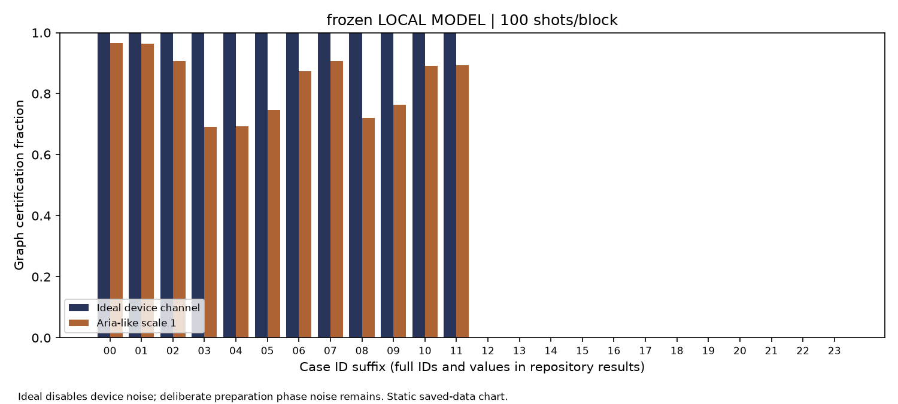
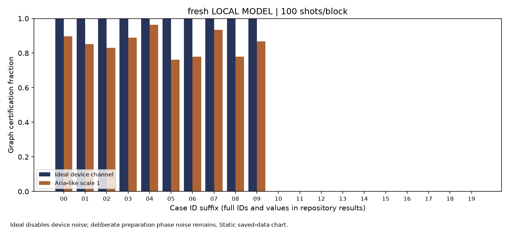
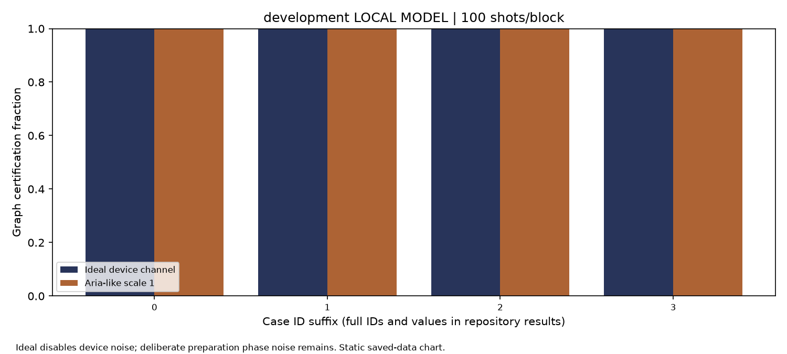

# Entanglement Court

Entanglement Court is a small interactive courtroom for testing graph-state entanglement evidence.
It pairs an entangled graph state with a separable product state that has the same ideal Z-basis distribution.
**Key result (LOCAL MODEL):** across 24 frozen and 20 fresh cases, certification was 0.50/0.50 in ideal simulation;
the Aria-like local model gave 0.42/0.43, with zero false certificates in product and biseparable controls.
The two-color comparator is the same witness implementation, so it ties by construction.
**Run it (judges): built-in simulator, default settings, press Run, about [[CLOUD: measured live built-in runtime will go here]] s; then check the matched Z exhibits and the conditional witness receipt.**

## Summary

The demo shows why matching computational-basis histograms cannot by themselves reveal entanglement. A judge can inspect both preparations, challenge the evidence with two measurement settings, and see a finite-sample lower bound and its assumptions. The project is an educational evidence game and coverage study; it is not a new entanglement theorem.

## The problem

Graph-state stabilizer witnesses can certify genuine multipartite entanglement, but a point estimate can overstate what finite measurements support. The exhibit makes this limitation visible by pairing a graph state and a separable equatorial product preparation with the same ideal Z distribution. The planned context cites finite-copy witness work, doi:10.1038/s41534-024-00810-3.

## How it works

The live run prepares a four-qubit connected graph state and a separable product state. Both have exactly uniform ideal Z probabilities, so their theoretical total-variation distance is zero. The program measures Z for the matching exhibit and measures graph stabilizers in two coloring bases. It computes parity counts, confidence bounds, and a conservative fidelity lower bound. The graph-state biseparable threshold is 1/2; the receipt certifies only when the lower bound is strictly above it.

The simultaneous bound allocates error probability across generator parities and reports a per-round guarantee under its measurement assumptions. A finite sample can cross a theoretical bound by chance; confidence intervals make sampling uncertainty visible. “Inconclusive” does not mean separable.

## Results

| Evidence | Label | Result |
|---|---|---|
| Frozen and fresh local campaign, 24 + 20 cases | LOCAL MODEL | Graph certification fraction: 0.50 / 0.50 in ideal simulation; 0.42 / 0.43 in the aria-like approximation. |
| Product and biseparable controls | LOCAL MODEL | Zero false certificates reported in the provenance summary. |
| Comparator | LOCAL MODEL | Two-color comparator and simultaneous generator witness are implementation-identical and tie; this is not a stronger-baseline win. |
| Qollab IonQ simulator subset | RECORDED | [[CLOUD: date, noise model, shots, and measured subset results will go here]] |

The local noise model approximates IonQ-like errors and is not a device result. The cloud subset is pending; no cloud outcome is claimed here.

**Evidence files in this project:** `evidence_summary.json` contains compact LOCAL MODEL statistics and source hashes; `recorded_ionq.py` holds the Qollab IonQ runs. Regenerate the summary with `python experiments/make_summary.py`.



*Alt text: Frozen-case campaign figure; graph-state certification is higher for easy cases than near-threshold cases, where inconclusive outcomes are expected.*



*Alt text: Fresh-case campaign figure; local-model certification is summarized across fresh instances and separated by case stratum.*



*Alt text: Development exhibit showing matched Z histograms, stabilizer parity intervals, and a conditional witness lower bound.*

## How to run (and replicate)

### Built-in simulator

Open the project in Qollab, select **Built-in simulator**, leave the form at its defaults, and press **Run**. Review the paired Z histograms, the two stabilizer exhibits, and the receipt's trusted-measurement condition. The runtime shown at the top will be updated from the saved live-run measurement.

### IonQ simulator slots

Cloud numbers are pending: [[CLOUD: list the actual recorded slot dates, noise model, shots, and results here]]. When a scheduled slot is available, choose the Qollab IonQ simulator and use its preregistered slot setting; each slot is one packed circuit and one job. Only report captured Qollab receipts as RECORDED evidence, with date, model, and shots.

### Local reproduction

From this folder, use the repository Python environment:

```powershell
..\..\.venv\Scripts\python.exe experiments/run.py --suite frozen --independent-manifest review/manifests/frozen.json --draws 1000 --output-dir results/frozen-reproduction
..\..\.venv\Scripts\python.exe experiments/run.py --suite fresh --independent-manifest review/manifests/fresh.json --draws 1000 --output-dir results/fresh-reproduction
```

These commands describe how to reproduce local campaigns; they are not claims that those commands were run for this page. The local IonQ-like simulation is an approximation, not a Qollab cloud receipt.

### Replicate and extend

To replicate the local evidence, run `python experiments/run.py --suite frozen --independent-manifest review/manifests/frozen.json` (and `--suite fresh` with `fresh.json`) from the repository. To extend it, add new graph/product preparations in `cases.py` or new witness terms in `witness.py`, then add matching independent manifests.

## What is new

The contribution is the adversarial matched-preparation exhibit, its frozen case sets, and an accessible evidence receipt that names its assumptions. Graph-state witnesses and finite-sample confidence methods are established techniques. This work does not claim a new theorem, speedup, or superiority to a stronger witness.

## Limits

The comparator uses the same witness measured in two ways, so results tie by construction. The local noise model is approximate. A successful cloud receipt is conditional on trusted measurement rotations and readout; systematic measurement error is otherwise unbounded. The local campaign's results do not establish hardware performance. Near-threshold cases can be inconclusive. Zero observed false certificates in finite controls is not proof of a zero population risk, and these per-round intervals do not create a campaign-wide guarantee.

## Judging-criteria summary

- **Novelty and creativity:** an adversarial courtroom pairs preparations that look identical in Z and invites a measurement challenge; the witness itself is established.
- **Technical execution:** six measurement blocks are run together for the IonQ simulator's one-circuit-per-job constraint; evidence is computed from counts and confidence bounds.
- **Impact potential:** the demo teaches the difference between matching samples and entanglement evidence, including when evidence is insufficient.
- **Documentation quality:** run instructions, saved figures, result labels, assumptions, reproduction commands, and limitations are provided.

## Accessibility

The companion web interface supports keyboard operation, uses high-contrast colors with text labels and symbols so color is not the only cue, and exposes exhibits and status as readable text for screen readers. No audio is required; any demo-video narration should include captions.

## Disclosure

AI tools used during the build window: AgentMesh routing to OpenCode free models, OpenAI Codex models, and Claude Code. Shared helper code in `circuit_pack.py` and `receipt.py` was written during Oct 9–11, 2026 and is also used by Two Whispers Make a Word and Never Lose Twice; this project's manifest identifies its helper use. Project-specific preparation, witness, decoding, and presentation code is described above. Dependencies are Qiskit 2.x (Apache-2.0), NumPy (BSD-3-Clause), SciPy (BSD-3-Clause), and Matplotlib (PSF-based license); see their upstream license files. No extra Qollab template or third-party project code is claimed as reused. The Qollab runtime documentation and hackathon rules were consulted.

**Theme:** Quantum Unlocked

**License:** MIT; see [LICENSE](LICENSE).

This effort is supported by Qollab & IonQ.

**Repository:** https://github.com/sauravdasmg/Qollab  
**Demo video:** [[VIDEO LINK]]
