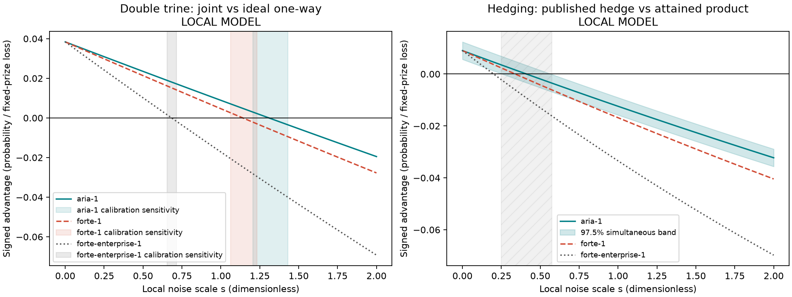

# The Noise Tax: when does noise erase a quantum strategy's margin?

**Run it (judges):** built-in simulator, default settings (512 shots, aria-1), press **Run**, about 20 s; check the live W and N scores, recorded anchors, and modeled curves.

**Summary.** The Noise Tax compares two specific quantum-game recipes with their stated references while increasing a calibrated local noise model. Across 24 paired instances, the modeled signed margins cross zero; the detailed estimates and uncertainty are below. These are **LOCAL MODEL** findings, not device thresholds.

**Problem.** Ideal quantum strategies can have an advantage over a chosen reference, but a noisy implementation may change that margin. This demo makes the comparison and assumptions visible. The project plan supplies no paper identifiers to cite here; it adds none.

**How it works.** The live Qiskit program prepares a double-trine discrimination game and a two-test hedging game, samples both arms on the injected backend, then prints word error, failure rates, and fixed-prize loss. Its precomputed curves use a shared calibrated IonQ-like approximation over noise scales 0 to 2 in steps of 0.025. Positive signed advantage favors the first-named strategy. Frozen and fresh local runs each use 24 seeded instances.

**Results — LOCAL MODEL (not device data).** W roots are deterministic for the stated model; ranges are calibration sensitivity, not confidence intervals. N intervals are 97.5% paired-instance bootstrap simultaneous-band intervals.

| Model | W frozen / fresh s* | W calibration sensitivity | N frozen s* [interval] | N fresh s* [interval] |
|---|---:|---:|---:|---:|
| aria-1 | 1.309 / 1.309 | 1.206–1.431 | 0.411 [0.250, 0.575] | 0.295 [0.150, 0.450] |
| forte-1 | 1.141 / 1.141 | 1.062–1.233 | 0.339 [0.200, 0.475] | 0.243 [0.125, 0.375] |
| forte-enterprise-1 | 0.684 / 0.684 | 0.655–0.716 | 0.200 [0.100, 0.300] | 0.144 [0.050, 0.225] |




**RECORDED** Qollab IonQ simulator case-0 anchors were recorded on 2026-10-10 UTC: W at 1,000 shots per label; N at 4,000 shots per arm for aria-1 and 1,000 per arm for forte-1 and forte-enterprise-1. Recorded anchors do not establish a cloud crossover: [[CLOUD: measured cloud result and interpretation will go here]].

Finite-shot estimates can cross a bound by sampling chance; interpret each estimate with its uncertainty interval. **LIVE** built-in results are the judge-facing run; **RECORDED** denotes the named Qollab IonQ simulator runs; **LOCAL MODEL** denotes the calibrated approximation.

**Run it yourself.** On Qollab, select the built-in simulator, keep defaults, and press Run. On the IonQ simulator, use a slot defined in `cloud_slots.py`; the slot receipt records its noise model and shots. Local reproduction from the repository root:

```powershell
.\.venv\Scripts\python.exe experiments\run.py --suite frozen
.\.venv\Scripts\python.exe experiments\run.py --suite fresh
.\.venv\Scripts\python.exe tools\qollab_local.py run projects\noise-tax --backend ideal --shots 512
```

**What is new.** One inspectable demo presents two different quantum comparisons, their modeled crossings, instance uncertainty, calibration sensitivity, and discrete measured anchors together. It does not claim new ideal strategies or new noise physics.

**Limits.** No speedup or noise reduction is shown. The local model approximates IonQ noise and cannot certify device thresholds. W compares the joint recipe with an ideal one-way sequential reference, not all LOCC or separable measurements. N compares the fixed published hedge with an attained product recipe at one fixed prize, not a globally optimal noisy product strategy. The W root is deterministic in the model with calibration sensitivity; N has bootstrap intervals. Cloud anchors do not make a cloud sweep. Negative margins mean the named comparator wins; neither comparison says classical computation beats quantum computation generally.

**Judging criteria.** Novelty and creativity: an interactive cross-game view of modeled noise thresholds. Technical execution: Qiskit circuits, shared approximate channel, seeded suites and receipts. Impact potential: a clear way to inspect how noise changes specific quantum-game margins. Documentation quality: definitions, commands, figures with alt text, accessibility and scope limits.

**Accessibility.** Keyboard-operable controls, labeled values, a light high-contrast display, and textual results accompany plots; color is not the only cue. No audio is needed. The video should provide captions or subtitles.

**Disclosure.** AI tools: AgentMesh routing (including OpenCode free models), OpenAI Codex models, and Claude Code. `circuit_pack.py` is the shared helper created in-window and used by Entanglement Court, Eyes-Free, and The Noise Tax; it packs circuits for Qollab's one-job interface and unpacks their counts. Game logic, analysis, UI, and results are specific to this entry. See `reuse_sources.json` for other reused or adapted sources. Libraries: Qiskit (Apache-2.0), NumPy (BSD-3-Clause), SciPy (BSD-3-Clause), Matplotlib (Matplotlib license), and Python standard library (PSF License). Qollab docs and templates were consulted; platform runtime patterns are disclosed here. MIT licence: see `LICENSE`.

**Theme:** Quantum Unlocked.

**Attribution:** This effort is supported by Qollab & IonQ.

**Repository:** https://github.com/sauravdasmg/Qollab  
**Video:** [[VIDEO LINK]]
