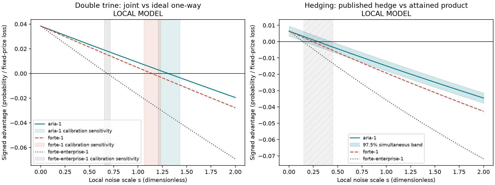
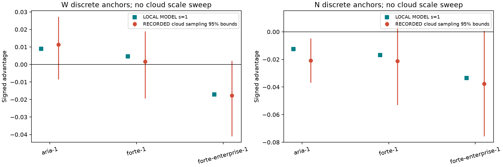

# The Noise Tax

Two familiar quantum strategies meet a calibrated, local IonQ-like noise model: when does their measured advantage cross zero?

LOCAL MODEL: across 24 paired instances, both comparisons cross as modeled noise rises; see the frozen and fresh estimates below.

**Run it (judges):** choose the built-in simulator; leave defaults (512 shots, aria-1); press **Run** (about 20 s); then check the two live score summaries, recorded IonQ anchors, and noise curves.

## Summary

The Noise Tax is a compact benchmark and interactive explanation of modeled noise thresholds for two specific comparisons: a joint measurement against an ideal one-way reference on the double-trine game, and a published hedging strategy against an attained product strategy on a fixed prize. Its signed advantage is positive when the named recipe wins and negative when its named comparator wins.

Results distinguish **LIVE** built-in runs, **RECORDED** Qollab IonQ simulator runs, and **LOCAL MODEL** results from a calibrated IonQ-like approximation. A local-model crossing is conditional on that model; it is not an IonQ device threshold.

## The problem

Quantum strategies can outperform a selected reference in an idealized setting, while noise changes their measured outcomes. We ask how the signed margin changes as a specified local noise scale increases, and show how that answer depends on the model. The comparisons are deliberately narrow: the one-way ideal reference is not every separable or LOCC measurement, and the product strategy is itself quantum.

The project plan does not list citable paper identifiers. No paper identifier is added here; theoretical recipes and their attribution are described in the experiment plan and code.

## How it works

The live entry prepares small Qiskit circuits for three equiprobable double-trine labels and for two four-qubit hedging arms, runs them on the injected backend, and prints estimated errors, failure rates, and fixed-prize loss. It displays stored local sweeps beside the live run and historical cloud measurements. Cloud data are separate anchor observations; cloud noise scale is not adjustable and no cloud crossover is fitted.

For the local study, the same calibrated channel semantics are applied across the games after compilation. The W metric is ideal one-way word error minus joint-measurement word error. The N metric is product loss minus hedge loss, where loss is double-failure probability plus 0.02 times the expected number of unused passes. A positive sign favors the first-named recipe in each definition. Frozen and fresh sets each use 24 seeded instances and a grid from 0 to 2 in steps of 0.025.

## Results

All table values below are **LOCAL MODEL** (calibrated IonQ-like approximation; not device data). W has a deterministic root for this model and a calibration-sensitivity range, not a sampling confidence interval. N uses a 97.5% paired-instance bootstrap simultaneous-band interval. The frozen and fresh N intervals overlap for each model.

| Comparison | Model | Frozen crossing s* | Fresh crossing s* | Uncertainty / interpretation |
|---|---|---:|---:|---|
| W joint vs ideal one-way | aria-1 | 1.309 | 1.309 | deterministic; calibration sensitivity 1.206–1.431 |
| W joint vs ideal one-way | forte-1 | 1.141 | 1.141 | deterministic; calibration sensitivity 1.062–1.233 |
| W joint vs ideal one-way | forte-enterprise-1 | 0.684 | 0.684 | deterministic; calibration sensitivity 0.655–0.716 |
| N product vs published hedge | aria-1 | 0.411 | 0.295 | frozen CI 0.250–0.575; fresh CI 0.150–0.450 |
| N product vs published hedge | forte-1 | 0.339 | 0.243 | frozen CI 0.200–0.475; fresh CI 0.125–0.375 |
| N product vs published hedge | forte-enterprise-1 | 0.200 | 0.144 | frozen CI 0.100–0.300; fresh CI 0.050–0.225 |

**LOCAL MODEL figures.** The plots show signed advantage versus modeled noise scale for frozen solid and fresh dashed curves; N also shows instance-bootstrap bands, while W shows calibration sensitivity traces. Recorded anchors appear in a separate figure. These plots come from the project's result bundle and are also drawn by `main()`.






**RECORDED** Qollab IonQ simulator measurements in `recorded_ionq.py` include W and N case-0 anchors for aria-1, forte-1, and forte-enterprise-1. Recorded run dates are 2026-10-10 UTC. W runs used 1,000 shots per label. N aria-1 used 4,000 shots per arm; N forte-1 and forte-enterprise-1 used 1,000 shots per arm. The noise model is named explicitly for each record. Cloud-scale crossings: [[CLOUD: measured cloud result and interpretation will go here]].

**Sampling noise:** finite-shot estimates can cross a theoretical or comparison bound by chance; read the reported uncertainty interval with the estimate. A local-model interval describes instance variation under the stated approximation and does not cover remote pulse-model mismatch.

## Run it yourself

### Built-in simulator

On Qollab, select the built-in simulator and press Run with the default form values (512 shots, aria-1). The run prints live estimates and labels results as LIVE; stored curves and anchors are separate LOCAL MODEL and RECORDED evidence. The page's main program generates small circuits and evaluates both games in one run.

### IonQ simulator slots

Choose an available slot through the `slot` parameter only when running the project on the Qollab IonQ simulator; the run records the selected noise model, shot count and receipt. Available slot names and budgets are defined in `cloud_slots.py`. IonQ results are useful as measured anchors; they add no judging points and do not create a tunable cloud noise sweep. Do not select a real QPU.

### Local reproduction

From the parent Qollab repository, run the experiment suites and built-in emulation with the project's dependencies installed:

```powershell
..\..\.venv\Scripts\python.exe experiments\run.py --suite frozen
..\..\.venv\Scripts\python.exe experiments\run.py --suite fresh
..\..\.venv\Scripts\python.exe tools\qollab_local.py run projects\noise-tax --backend ideal --shots 512
```

These commands describe how to reproduce the work; their outcomes are reported in the results files, not promised by the command text.

## What is new

The project puts two different quantum-game comparisons on a shared, inspectable noise-scale view, with frozen and independently seeded fresh curves, uncertainty distinctions, and recorded cloud anchors shown separately. This is a reproducible comparison and teaching tool. It does not claim that the underlying ideal strategies or noise channels are new.

## Limits

- No speedup, practical advantage, or noise reduction is demonstrated.
- The local channel is a calibrated IonQ-like approximation, not the device or a complete remote noise model. Calibration sensitivity is distinct from statistical confidence.
- W's comparator is an ideal optimal one-way sequential reference, not all LOCC or separable measurements. Its deterministic W crossing has calibration sensitivity, not an instance-bootstrap CI.
- N compares a fixed published hedge with the attained product recipe under one fixed prize. It does not certify a globally optimal noisy product strategy.
- The N crossover is deterministic for each computed mean curve; its interval reflects seeded instance uncertainty. The cloud observations are discrete measured anchors, not a cloud threshold.
- Results do not imply that a classical strategy beats quantum computation generally. Negative margins are shown plainly as wins for the named comparator.

## Judging-criteria summary

- **Novelty and creativity:** an interactive comparison of two distinct strategy margins and their modeled crossover behavior, with model mismatch made visible.
- **Technical execution:** Qiskit circuits, a shared approximate channel, seeded result bundles, crossover analysis, and separate recorded run receipts.
- **Impact potential:** helps learners and researchers see why ideal performance and noisy observed performance can differ, while showing the assumptions behind that comparison.
- **Documentation quality:** includes reproduction commands, definitions, plotted results with alt text, accessible interaction notes, and explicit limits.

## Accessibility

The interactive page supports keyboard operation and shows values and labeled controls alongside plots; contrast uses a light background with high-contrast text. Results are available as text and figures, so screen readers need not interpret color alone. No audio is required. Captions are not applicable because the demo has no audio content; the linked video should include voice captions or subtitles.

## Disclosure

**AI tools:** AgentMesh routing (including OpenCode free models), OpenAI Codex models, and Claude Code were used during development and documentation. Work was produced during the hackathon window.

**Reused code:** `circuit_pack.py` is the shared packing helper written during this hackathon window and used by Entanglement Court, Eyes-Free, and The Noise Tax. It packs small circuits into one circuit for the Qollab IonQ one-job-per-run interface and splits measured counts back into their original blocks. This project's game logic, noise analysis, UI, and results are project-specific. Other reused or adapted material, if any, is identified in `reuse_sources.json`.

**Libraries and licences:** Qiskit (Apache-2.0), NumPy (BSD-3-Clause), SciPy (BSD-3-Clause), and Matplotlib (custom Matplotlib license); Python standard library components use the Python Software Foundation License. Dependencies are listed in `requirements.txt`. MIT project licence is included in `LICENSE`.

**Platform references:** Qollab runtime documentation, hackathon rules, and project templates were consulted. The project follows the Qollab injected-backend and circuit-packing interface; no claim of original platform code is made.

**Attribution:** This effort is supported by Qollab & IonQ.

**Theme tag:** Quantum Unlocked.

**Repository:** https://github.com/sauravdasmg/Qollab

**Demo video:** [[VIDEO LINK]]

## Licence

MIT. See [LICENSE](LICENSE).
